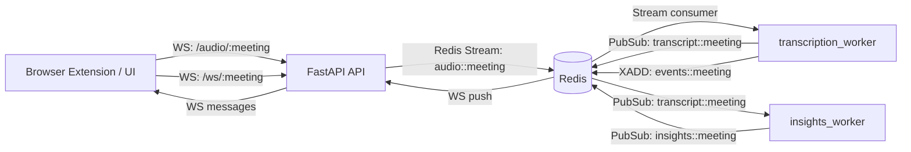
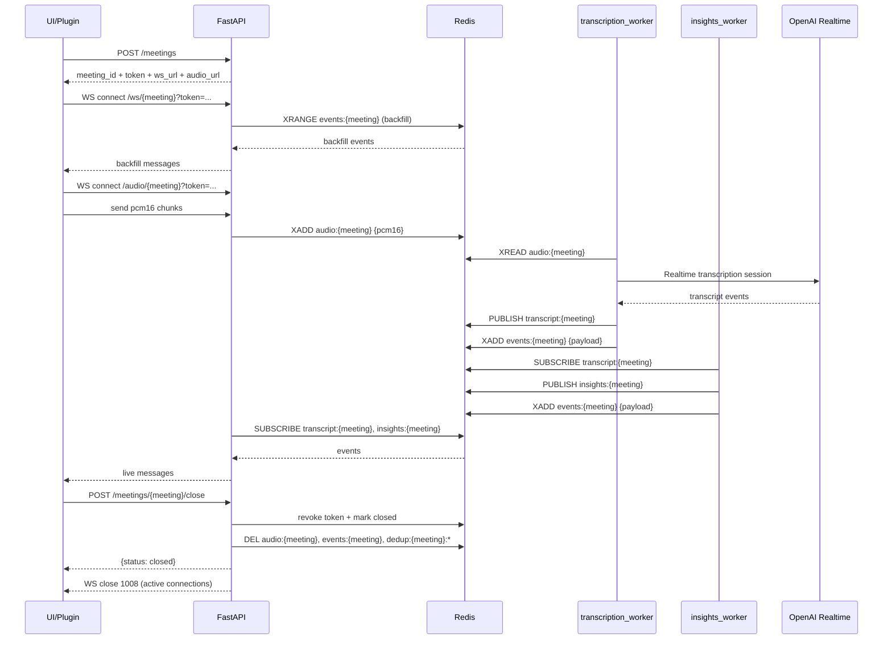

# Context AI Plugin — Real‑time Meeting Copilot 🎧🧠


A real‑time conversation assistant that captures live audio, produces real‑time transcripts, generates helpful insights, detects questions, and streams everything back to a UI (browser extension) over WebSockets.

This repository currently contains:
- A FastAPI backend (meeting lifecycle + WebSocket gateways)
- Background workers (transcription router + insights generation)
- Browser extension (Chrome/Edge) for real-time meeting copilot
- Client scripts that simulate the browser extension behavior

---

## ✨ What it does

- **Live microphone streaming** (PCM16 @ 24kHz)
- **Client-side VAD** to avoid sending long silence segments
- **Realtime transcription** (OpenAI Realtime API — transcription intent)
- **Insights generation** (summaries, key terms, action hints)
- **Question detection + answers (QA)** when the user asks something directly
- **Unified meeting WebSocket** for UI/plugin: backfill + live stream in one socket
- **Multi‑meeting support** with per‑meeting token auth
- **Meeting lifecycle**: create → use → close → cleanup (Redis purge + session shutdown)

---

## 🧱 System Architecture

### High‑level flow



### Event stream model (UI receives)

The UI receives a single WebSocket stream (`/ws/{meeting_id}`) that can include:

- `transcript.completed` (final transcript chunk for a spoken turn)
- `insight` (generated insight payload)
- `qa` (question detected + answer)

Backfill is replayed from `events:{meeting_id}` and then live events continue via PubSub.

---

## 🔐 Meeting Lifecycle & Security

### Token model

- A meeting is created using `POST /meetings` which returns:
  - `meeting_id`
  - `token`
  - `ws_url` (unified websocket)
  - `audio_url` (audio websocket)
  - TTL

- `GET /meetings/{meeting_id}?token=...` returns meeting status (`open`) and `expires_in_seconds` when token is valid; returns 401 otherwise.
- `POST /meetings/{meeting_id}/refresh` with body `{"token": "..."}` returns a new token and updated `ws_url`/`audio_url`; use it to renew before expiry (e.g. reconnecting or long meetings).
- All WebSocket routes require `?token=`.
- On meeting close:
  - token is revoked
  - active WS connections are killed (`1008 policy violation`)
  - Redis keys are purged (`audio:*`, `events:*`, `dedup:*`)

### Sequence: create → use → close



---

## 📂 Project Structure

```text
CONTEXT_AI_PLUGIN/
│
├── backend/
│   ├── config.py               # Environment configuration
│   ├── main.py                 # FastAPI server (meetings, websockets, auth, lifecycle)
│   └── requirements.txt
│
├── extension/
│   ├── manifest.json           # Chrome extension manifest (V3)
│   ├── background.js           # Minimal service worker (side panel behavior)
│   ├── popup.html              # Extension popup UI
│   ├── popup.js                # Popup logic (audio capture, WebSocket, UI)
│   ├── content.js              # Content script (placeholder for future overlay)
│   ├── styles.css              # Popup styles
│   ├── icons/                  # Extension icons (16x16, 48x48, 128x128)
│   └── README.md               # Extension setup instructions
│
├── client/
│   ├── __init__.py
│   ├── audio_sender.py         # Streams microphone audio (PCM16 24kHz)
│   ├── create_meeting.py       # Creates meeting + token
│   ├── events_listener.py      # Legacy (split streams) listener
│   ├── insights_listener.py    # Legacy insights listener
│   └── unified_ws_listener.py  # Simulates plugin: unified backfill + live stream
│
├── worker/
│   ├── __init__.py
│   ├── transcription_worker.py # Multi-meeting realtime transcription router
│   ├── insights_worker.py      # Generates insights + QA
│   └── prompts.py              # Centralized AI prompts
│
├── observability/              # Local generated reports (gitignored)
│   └── meetings/{meeting_id}/
│       ├── events_YYYY_MM_DD_HH_MM_SS.jsonl
│       ├── metrics_YYYY_MM_DD_HH_MM_SS.json
│       └── report_YYYY_MM_DD_HH_MM_SS.md
│
├── docker-compose.yml
├── Dockerfile
├── pyproject.toml
├── uv.lock
├── .env
└── README.md
```

---

## ✅ Requirements

- Python **3.12+**
- Docker + Docker Compose
- A Redis instance (included via compose)
- `OPENAI_API_KEY` set in your environment (or `.env`)

---

## 🔧 Configuration

### Environment variables

| Variable | Used by | Default | Notes |
|---|---|---:|---|
| `OPENAI_API_KEY` | workers | — | Required |
| `API_BASE_URL` | api | `http://localhost:8000` | Public base URL for `ws_url`/`audio_url` in create/refresh (http→ws, https→wss) |
| `REDIS_HOST` | api/workers | `localhost` | In Docker: `redis` |
| `REDIS_PORT` | api/workers | `6379` | — |
| `MEETING_TOKEN_TTL_SECONDS` | api | `7200` | Token lifetime |
| `MEETING_CLOSED_TTL_SECONDS` | api | `7200` | Closed flag retention |
| `OBSERVABILITY_ROOT` | api | `observability/meetings` | Local folder for post-meeting artifacts |
| `TRANSCRIPTION_COST_PER_MINUTE_USD` | api | `0.003` | Estimated transcription cost used in reports |
| `INSIGHTS_MODEL` | insights_worker | `gpt-4o-mini` | Chat model |
| `INSIGHTS_INPUT_COST_PER_1M_USD` | insights_worker | `0.15` | Estimated input token cost for reports |
| `INSIGHTS_OUTPUT_COST_PER_1M_USD` | insights_worker | `0.60` | Estimated output token cost for reports |
| `INSIGHTS_MAX_OUTPUT_TOKENS` | insights_worker | `180` | Max output tokens per insights call |
| `QA_MAX_OUTPUT_TOKENS` | insights_worker | `220` | Max output tokens per QA call |
| `INSIGHTS_QA_WORKERS` | insights_worker | `2` | Dedicated worker threads for Q&A so answers are not blocked by insights |
| `INSIGHTS_INSIGHT_WORKERS` | insights_worker | `1` | Worker threads for insights generation |
| `INSIGHTS_PENDING_LIMIT_PER_MEETING` | insights_worker | `1` | Caps queued insights per meeting to avoid stale backlog |
| `INSIGHTS_BACKGROUND_DELAY_SECONDS` | insights_worker | `0.5` | Small delay before insight calls; Q&A remains priority |
| `INSIGHTS_QUESTION_MIN_WORDS` | insights_worker | `4` | Ignore very short/non-actionable questions |
| `INSIGHTS_QUESTION_ASSEMBLY_WINDOW_SECONDS` | insights_worker | `5.0` | Join nearby short transcript chunks before Q&A |
| `INSIGHTS_QUESTION_ASSEMBLY_MAX_PARTS` | insights_worker | `4` | Max chunks to join for a fragmented question |
| `INSIGHTS_QA_MIN_INTERVAL_SECONDS` | insights_worker | `1.5` | Minimum interval between QA publishes per meeting |
| `INSIGHTS_HISTORY_MAXLEN` | insights_worker | `12` | Rolling window |
| `INSIGHTS_CONTEXT_TAKE_LAST` | insights_worker | `8` | Context slice |
| `INSIGHTS_DEDUP_TTL_SECONDS` | insights_worker | `120` | TTL for dedup of repeated insight payloads |
| `INSIGHTS_MIN_NEW_TOKENS` | insights_worker | `8` | Minimum context novelty to trigger insight call |
| `INSIGHTS_CONTEXT_SIMILARITY_THRESHOLD` | insights_worker | `0.85` | Lower values reduce insight frequency |
| `MAX_ACTIVE_MEETINGS` | transcription_worker | `8` | Router capacity |
| `MEETING_IDLE_TIMEOUT_SECONDS` | transcription_worker | `30` | Auto stop |
| `OBSERVABILITY_STORE_TRANSCRIPT_DELTAS` | transcription_worker | `false` | Store `transcript.delta` in JSONL only when debugging |
| `TURN_DETECTION_THRESHOLD` | transcription_worker | `0.5` | Realtime server VAD sensitivity |
| `TURN_PREFIX_PADDING_MS` | transcription_worker | `250` | Leading audio kept per turn |
| `TURN_SILENCE_DURATION_MS` | transcription_worker | `700` | Silence needed to finalize a turn (lower = faster, higher = less fragmented) |

> Tip: to reduce model cost, tune `INSIGHTS_MIN_NEW_TOKENS` up and `INSIGHTS_CONTEXT_SIMILARITY_THRESHOLD` down.

### Extension audio upload (VAD)

The extension uses client-side VAD in `extension/popup.js` and only sends frames when speech is detected (plus a short hangover window):

- `VAD_ENABLED`
- `VAD_RMS_THRESHOLD`
- `VAD_PEAK_THRESHOLD`
- `VAD_HANGOVER_MS`
- `VAD_BYPASS_WITHOUT_MIC`
- `VAD_CALIBRATION_MS`

The report shows whether VAD gating was really active, why it was bypassed, the calibrated noise floor, and the effective thresholds used during the meeting.

### Post-meeting observability

When a meeting is closed, the API writes local artifacts before purging Redis:

```text
observability/meetings/{meeting_id}/events_YYYY_MM_DD_HH_MM_SS.jsonl
observability/meetings/{meeting_id}/metrics_YYYY_MM_DD_HH_MM_SS.json
observability/meetings/{meeting_id}/report_YYYY_MM_DD_HH_MM_SS.md
```

The files include transcript history, insights, Q&A, VAD metrics, token usage, latency summaries, and estimated cost. The Docker Compose API service mounts `./observability` into the container so these files remain available on the host.

---

## 🚀 Run locally (end‑to‑end)

### Opção A: Usar a Browser Extension (recomendado)

1. **Start services**

```bash
docker compose up --build
```

2. **Instalar extensão**

- Abra Chrome/Edge e vá para `chrome://extensions/` (ou `edge://extensions/`)
- Ative "Modo do desenvolvedor"
- Clique em "Carregar sem compactação"
- Selecione a pasta `extension/` deste repositório

3. **Usar a extensão**

- Clique no ícone da extensão na barra de ferramentas
- Clique em "Iniciar Reunião"
- Permita acesso ao microfone quando solicitado
- A transcrição, insights e Q&A aparecerão em tempo real na popup

Veja `extension/README.md` para mais detalhes.

---

### Opção B: Usar scripts client (teste/desenvolvimento)

### 1) Start services

```bash
docker compose up --build
```

### 2) Create a meeting (returns meeting_id + token)

```bash
python client/create_meeting.py
```

Export the returned values:

```bash
export MEETING_ID="..."
export TOKEN="..."
```

### 3) Start unified listener (simulates the plugin)

```bash
python client/unified_ws_listener.py
```

### 4) Start audio streaming

```bash
python client/audio_sender.py
```

### 5) Check meeting status (optional)

```bash
curl "http://localhost:8000/meetings/$MEETING_ID?token=$TOKEN"
```

### 6) Refresh token (optional, for long meetings)

```bash
curl -X POST "http://localhost:8000/meetings/$MEETING_ID/refresh" -H "Content-Type: application/json" -d "{\"token\": \"$TOKEN\"}"
```

Update `TOKEN` (and reconnect WebSockets if needed) with the new token from the response.

### 7) Close meeting (kills active sockets + cleans Redis)

```bash
curl -X POST "http://localhost:8000/meetings/$MEETING_ID/close"
```

---

## 🧪 Quick sanity checks

### Health

```bash
curl http://localhost:8000/health
```

### Confirm Redis cleanup after close (optional)

```bash
docker exec -it <redis_container> redis-cli EXISTS "audio:$MEETING_ID"
docker exec -it <redis_container> redis-cli EXISTS "events:$MEETING_ID"
docker exec -it <redis_container> redis-cli SCAN 0 MATCH "dedup:$MEETING_ID:*" COUNT 10
```

Expected:
- `audio:*` and `events:*` → `0` after close
- `dedup:*` → empty

---

## 🧯 Troubleshooting

### Audio connects then closes with 1008
This means the meeting is **closed** or the `token` is **invalid/expired**.

- Re-create a meeting with `python client/create_meeting.py`
- Export the new `MEETING_ID` + `TOKEN`

### No transcripts
- Check `OPENAI_API_KEY` is set for the `transcription` container.
- Ensure your microphone works and sample rate is 24kHz.
- Confirm `audio_sender.py` is pointing to the correct meeting/token.

### Insights not showing
- Confirm `insights_worker` is running.
- Verify `INSIGHTS_MODEL` and API key.
- Check `INSIGHTS_DEDUP_TTL_SECONDS`, `INSIGHTS_MIN_NEW_TOKENS` and `INSIGHTS_CONTEXT_SIMILARITY_THRESHOLD`.

---

## 🧠 AI Agents Instructions (IMPORTANT)

If you are an AI assistant helping with this repository:

**Read this section before proposing any change.**

### Current project state
This is an MVP/prototype with production‑oriented boundaries:
- Multi‑meeting support
- Token‑secured WebSockets
- Event‑driven streaming
- Worker scalability

### Architectural invariants (DO NOT BREAK)
1. **Multi‑meeting** must remain.
2. **Token auth** must protect **all** WebSocket routes.
3. Closing a meeting must:
   - revoke token
   - kill active sessions
   - clean Redis data
4. Workers must remain horizontally scalable.
5. Redis remains the single event bus + backfill storage.
6. Keep streaming event-driven (no redesign into batch polling).

### Do NOT suggest
- Removing Redis
- Removing WebSockets
- Reverting to single‑meeting architecture
- Synchronous/blocking designs that break realtime flow
- Polling-based “batch transcription” redesign

### How to propose improvements
- Prefer small, reviewable PRs
- Preserve streaming behavior and meeting lifecycle
- Keep clear boundaries: `backend/` vs `worker/` vs `client/`
- Avoid breaking existing client scripts

### Product goal
A browser plugin that provides real‑time conversational assistance during meetings.

---

## 🛣️ Roadmap (next milestones)

- ~~Meeting status endpoint (`GET /meetings/{meeting_id}`)~~ ✅
- ~~Token refresh / session renewal flow~~ ✅
- ~~URLs dinâmicas (`API_BASE_URL`)~~ ✅
- ~~Browser extension UI overlay~~ ✅
- Metrics + observability
- Production deployment (cloud)

---

Built for real‑time AI experiences 🚀
