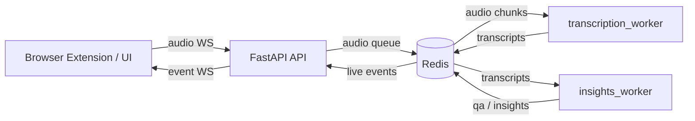
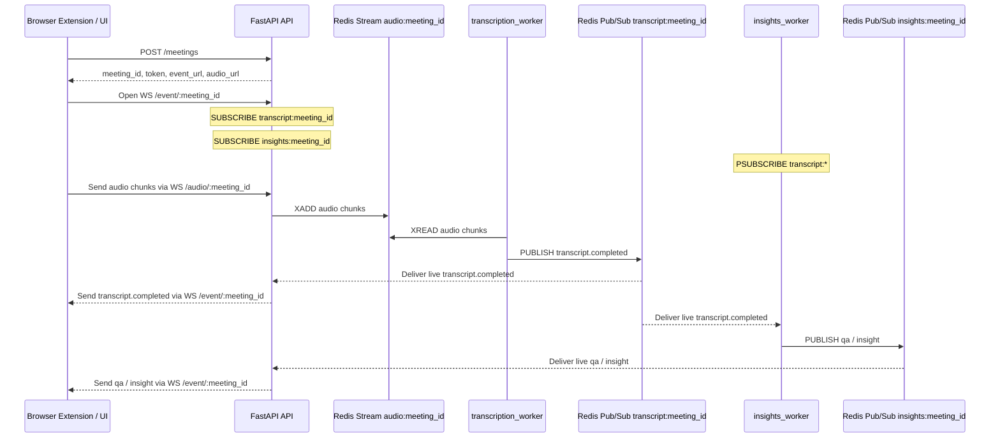
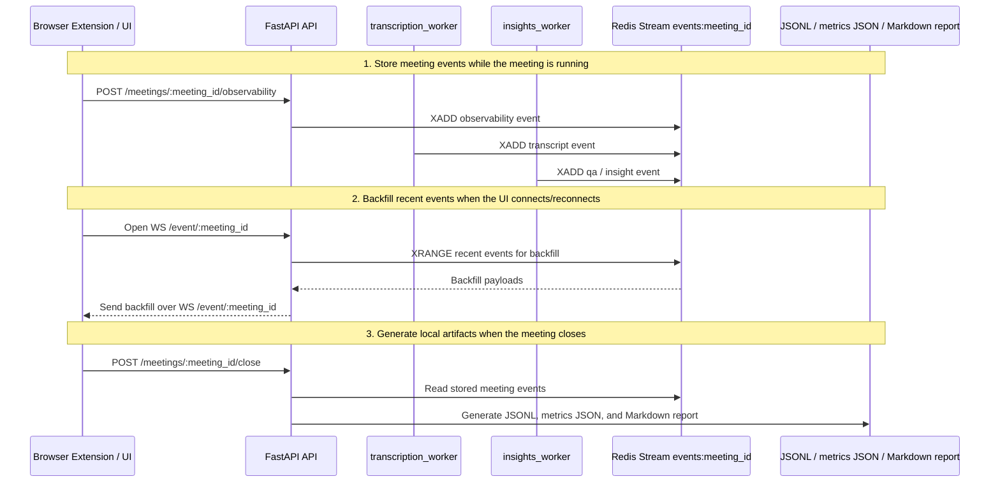

# Context AI Plugin — Real‑time Meeting Copilot 🎧🧠


A real‑time conversation assistant that captures live audio, produces real‑time transcripts, generates helpful insights, detects questions, and streams everything back to a UI (browser extension) over WebSockets.

This repository currently contains:
- A FastAPI backend (meeting lifecycle + WebSocket gateways)
- Background workers (transcription router + insights generation)
- Browser extension (Chrome/Edge) for real-time meeting copilot

---

## ✨ What it does

- **Live microphone streaming** (PCM16 @ 24kHz)
- **Client-side VAD** to avoid sending long silence segments
- **Realtime transcription** (OpenAI Realtime API — transcription intent)
- **Insights generation** (summaries, key terms, action hints)
- **Question detection + answers (QA)** when the user asks something directly
- **Meeting event WebSocket** for UI/plugin: backfill + live stream in one socket
- **Multi‑meeting support** with per‑meeting token auth
- **Meeting lifecycle**: create → use → close → cleanup (Redis purge + session shutdown)

---

## 🧱 System Architecture

### High‑level flow



### Main live event flow



### Report and backfill flow



### Event stream model (UI receives)

The UI receives a single WebSocket stream (`/event/{meeting_id}`) that can include:

- `transcript.completed` (final transcript chunk for a spoken turn)
- `insight` (generated insight payload)
- `qa` (question detected + answer)

Backfill is replayed from `events:{meeting_id}` and then live events continue via PubSub.

---

## 🔐 Meeting Lifecycle & Security

### Token model

- A meeting is created using `POST /meetings` which returns:
  - `meeting_id`
  - `token`
  - `event_url` (event websocket)
  - `audio_url` (audio websocket)
  - TTL

- `GET /meetings/{meeting_id}?token=...` returns meeting status (`open`) and `expires_in_seconds` when token is valid; returns 401 otherwise.
- `POST /meetings/{meeting_id}/refresh` with body `{"token": "..."}` returns a new token and updated `event_url`/`audio_url`; use it to renew before expiry (e.g. reconnecting or long meetings).
- All WebSocket routes require `?token=`.
- On meeting close:
  - token is revoked
  - active WS connections are killed (`1008 policy violation`)
  - Redis keys are purged (`audio:*`, `events:*`, `dedup:*`)

---

## 📂 Project Structure

```text
CONTEXT_AI_PLUGIN/
│
├── backend/
│   ├── main.py                 # FastAPI app composition
│   ├── configs.py              # Shared backend configuration
│   ├── src/
│   │   ├── integrations/
│   │   │   ├── redis.py
│   │   │   └── openai.py
│   │   ├── routes/
│   │   │   ├── meetings.py
│   │   │   └── websockets.py
│   │   └── workers/
│   │       ├── transcription_worker.py
│   │       ├── insights_worker.py
│   │       └── prompts.py
│
├── extension/
│   ├── manifest.json           # Chrome extension manifest (V3)
│   ├── backend/
│   │   └── background.js       # Extension service worker
│   ├── frontend/
│   │   ├── popup.html
│   │   ├── popup.js
│   │   ├── content.js
│   │   ├── styles.css
│   │   └── icons/
│   ├── observability/
│   │   └── observability.js
│   └── README.md
│
├── observability/
│   ├── backend/
│   │   └── observability.py
│   └── output/                 # Local generated reports (gitignored)
│       └── meetings/data_YYYY_MM_DD_HH_MM_SS/{meeting_id}/
│
├── docker-compose.yml
├── Dockerfile
├── pyproject.toml
├── uv.lock
├── .env
└── README.md
```

---

## ✅ Requirements

- Python **3.12+**
- Docker + Docker Compose
- A Redis instance (included via compose)
- `OPENAI_API_KEY` set in your environment (or `.env`)

---

## 🔧 Configuration

### Backend configs

Non-sensitive backend values now live in `backend/configs.py`, grouped by subject:

- `Config to Redis`
- `Config to API`
- `Config to OpenAI`
- `Config to Transcription`
- `Config to Insights`
- `Config to Observability`

Only `OPENAI_API_KEY` should come from the environment or `.env`.

### Extension audio upload (VAD)

The extension uses client-side VAD in `extension/frontend/popup.js` and only sends frames when speech is detected (plus a short hangover window):

- `VAD_ENABLED`
- `VAD_RMS_THRESHOLD`
- `VAD_PEAK_THRESHOLD`
- `VAD_HANGOVER_MS`
- `VAD_BYPASS_WITHOUT_MIC`
- `VAD_CALIBRATION_MS`

The report shows whether VAD gating was really active, why it was bypassed, the calibrated noise floor, and the effective thresholds used during the meeting.

### Post-meeting observability

When a meeting is closed, the API writes local artifacts before purging Redis:

```text
observability/output/meetings/data_YYYY_MM_DD_HH_MM_SS/{meeting_id}/events_YYYY_MM_DD_HH_MM_SS.jsonl
observability/output/meetings/data_YYYY_MM_DD_HH_MM_SS/{meeting_id}/metrics_YYYY_MM_DD_HH_MM_SS.json
observability/output/meetings/data_YYYY_MM_DD_HH_MM_SS/{meeting_id}/report_YYYY_MM_DD_HH_MM_SS.md
```

The files include transcript history, insights, Q&A, VAD metrics, token usage, latency summaries, and estimated cost. The Docker Compose API service mounts `./observability/output` into the container so these files remain available on the host.

---

## 🚀 Run locally (end‑to‑end)

1. **Start services**

```bash
docker compose up --build
```

2. **Instalar extensão**

- Abra Chrome/Edge e vá para `chrome://extensions/` (ou `edge://extensions/`)
- Ative "Modo do desenvolvedor"
- Clique em "Carregar sem compactação"
- Selecione a pasta `extension/` deste repositório

3. **Usar a extensão**

- Clique no ícone da extensão na barra de ferramentas
- Clique em "Iniciar Reunião"
- Permita acesso ao microfone quando solicitado
- A transcrição, insights e Q&A aparecerão em tempo real na popup

Veja `extension/README.md` para mais detalhes.

---

## 🧪 Quick sanity checks

### Health

```bash
curl http://localhost:8000/health
```

### Confirm Redis cleanup after close (optional)

```bash
docker exec -it <redis_container> redis-cli EXISTS "audio:$MEETING_ID"
docker exec -it <redis_container> redis-cli EXISTS "events:$MEETING_ID"
docker exec -it <redis_container> redis-cli SCAN 0 MATCH "dedup:$MEETING_ID:*" COUNT 10
```

Expected:
- `audio:*` and `events:*` → `0` after close
- `dedup:*` → empty

---

## 🧯 Troubleshooting

### Audio connects then closes with 1008
This means the meeting is **closed** or the `token` is **invalid/expired**.

- Start a new meeting from the browser extension.

### No transcripts
- Check `OPENAI_API_KEY` is set for the `transcription` container.
- Ensure your microphone/tab audio capture works in the browser extension.

### Insights not showing
- Confirm `insights_worker` is running.
- Verify `INSIGHTS_MODEL` in `backend/configs.py` and the API key.
- Check `INSIGHTS_DEDUP_TTL_SECONDS`, `INSIGHTS_MIN_NEW_TOKENS` and `INSIGHTS_CONTEXT_SIMILARITY_THRESHOLD` in `backend/configs.py`.

---

## 🧠 AI Agents Instructions (IMPORTANT)

If you are an AI assistant helping with this repository:

**Read this section before proposing any change.**

### Current project state
This is an MVP/prototype with production‑oriented boundaries:
- Multi‑meeting support
- Token‑secured WebSockets
- Event‑driven streaming
- Worker scalability

### Architectural invariants (DO NOT BREAK)
1. **Multi‑meeting** must remain.
2. **Token auth** must protect **all** WebSocket routes.
3. Closing a meeting must:
   - revoke token
   - kill active sessions
   - clean Redis data
4. Workers must remain horizontally scalable.
5. Redis remains the single event bus + backfill storage.
6. Keep streaming event-driven (no redesign into batch polling).

### Do NOT suggest
- Removing Redis
- Removing WebSockets
- Reverting to single‑meeting architecture
- Synchronous/blocking designs that break realtime flow
- Polling-based “batch transcription” redesign

### How to propose improvements
- Prefer small, reviewable PRs
- Preserve streaming behavior and meeting lifecycle
- Keep clear boundaries: `backend/src/` vs `extension/` vs `observability/`

### Product goal
A browser plugin that provides real‑time conversational assistance during meetings.

---

## 🛣️ Roadmap (next milestones)

- ~~Meeting status endpoint (`GET /meetings/{meeting_id}`)~~ ✅
- ~~Token refresh / session renewal flow~~ ✅
- ~~URLs dinâmicas (`API_BASE_URL`)~~ ✅
- ~~Browser extension UI overlay~~ ✅
- Metrics + observability
- Production deployment (cloud)

---

Built for real‑time AI experiences 🚀
